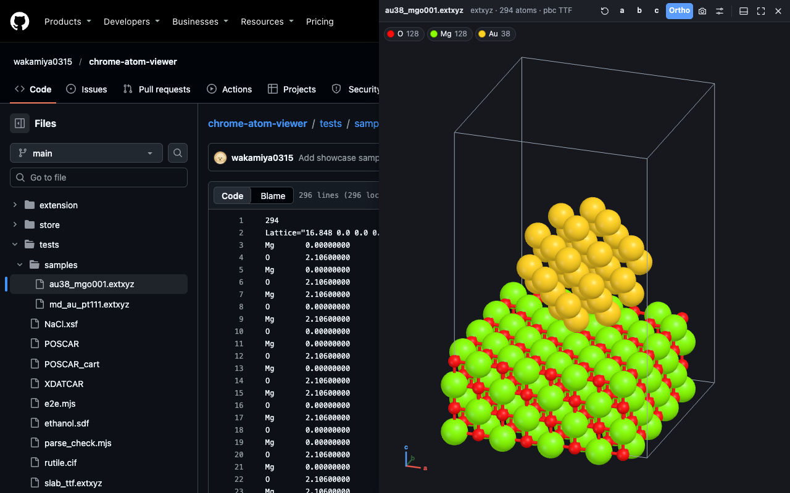
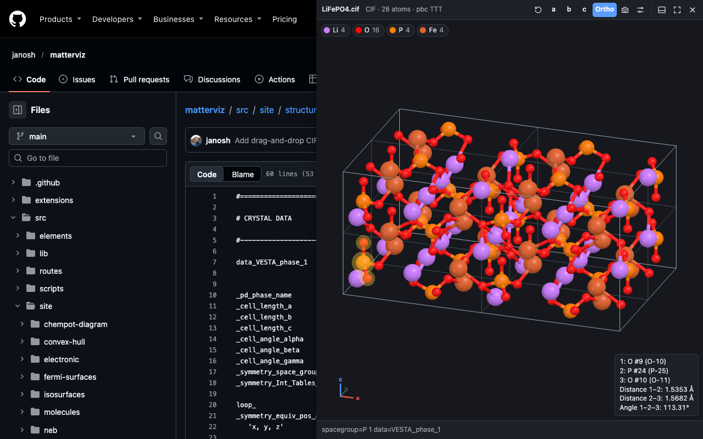
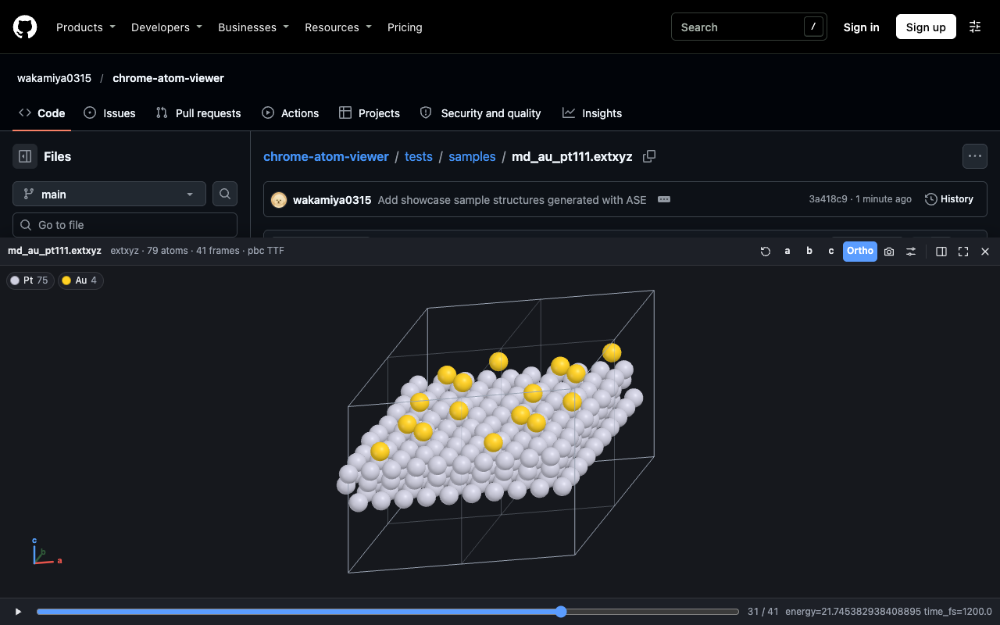

<p align="center"></p>

# Chrome Atom Viewer

A Chrome extension for viewing atomic structure files (`.xyz`, `.extxyz`, `.pdb`, `.cif`, `POSCAR`, …) on GitHub or any other web page in 3D, without downloading them. Right-click a file page or a link, and a viewer panel opens on the right or at the bottom of the page.

<p align="center">
  
</p>
<p align="center">
  
  
</p>
<p align="center"><sub>Left to right: Au₃₈ on MgO(001) · rutile 2×2×3 with an O–Ti–O angle · an Au/Pt(111) MD trajectory in the bottom panel. All three are files in <code>tests/</code>.</sub></p>

- **Works with private repositories.** The file is fetched with the page's own GitHub session (`github.com/<owner>/<repo>/raw/...`), so anything you can open in the browser can be viewed. Nothing is sent to an outside service.
- **No build step.** The code is plain ES modules with three.js vendored. After an edit, reload the extension on `chrome://extensions` and the change is live.

## Install

**From the Chrome Web Store:** [Atom Viewer](https://chromewebstore.google.com/detail/ldbcmecdchmhcjgboaagbiofojnjemhn). It is awaiting review, so the link works only once the listing is approved.

**From source:**

1. Clone this repository.
2. Open `chrome://extensions` in Chrome and turn on **Developer mode** (top right).
3. Click **Load unpacked** and select the `extension/` folder of the clone.
4. Optional: pin **Atom Viewer** from the puzzle-piece menu in the toolbar.

Chrome loads the extension directly from that folder, so keep the folder where it is.

## Usage

| Action | Result |
|---|---|
| Right-click on a file page (for example `.../blob/main/data/structure.extxyz`) → **View in Atom Viewer** | Shows that file |
| Right-click a **link** to a structure file → **View linked file in Atom Viewer** | Shows the linked file; works straight from a repository's file list |
| Select text, right-click → **View selected text in Atom Viewer** | Shows an XYZ / POSCAR / … block pasted in an issue, a gist or a code block |
| Toolbar button or **Alt+Shift+V** | Treats the current page as a structure file (the format is sniffed if the URL has no extension) |

On a Mac, right-click is a two-finger click.

### In the viewer

- **Mouse**: drag to rotate, scroll to zoom, right-drag to pan. Double-click an atom to make it the rotation center.
- **Selecting atoms**: click to select. With 2 atoms selected you get the distance, with 3 the angle, with 4 the dihedral. Hovering shows the coordinates and any per-atom extxyz properties (tags, forces, move_mask, …).
- **Header buttons**: reset view (`R`), view along `a` / `b` / `c`, `Ortho` to switch between orthographic (the default) and perspective projection (`O`), and save as PNG. The PNG has a transparent background, so it can go straight onto slides or figures.
- **Settings (slider icon)**: atom size, bonds (on/off, cutoff, thickness, metal–metal), unit cell, wrapping atoms into the cell, supercell (periodic directions only; the cell lines follow it, with the outer box solid and the unit-cell boundaries faint), and light background. **Reset settings** restores all of these to their defaults.
- **Legend**: click an element to hide or show it.
- **Trajectories** (multi-frame xyz/extxyz, XDATCAR, PDB `MODEL`s): use the slider and ▶ at the bottom, or `Space` and `←` / `→`.
- **Panel**: drag its edge to resize. Header buttons dock it right or bottom, make it full screen, or close it.

## Supported formats

| Format | Notes |
|---|---|
| XYZ / extended XYZ (`.xyz`, `.extxyz`) | `Lattice`, `Properties`, `pbc` and other key=value pairs; multiple frames |
| VASP (`POSCAR`, `CONTCAR`, `XDATCAR`, `.vasp`) | VASP 4/5, selective dynamics, Direct / Cartesian |
| CIF / mmCIF (`.cif`, `.mcif`, `.mmcif`) | symmetry operations are expanded; mmCIF uses Cartesian coordinates |
| PDB (`.pdb`, `.ent`) | `CRYST1`, `MODEL` / `ENDMDL` |
| XSF, MOL/SDF | basic structure only |
| any of the above as `.gz` | decompressed in the browser |

A bond is drawn when at least one of the two atoms is a non-metal and their distance is below 1.1 × the sum of their covalent radii. The factor can be changed in the settings, and metal–metal bonds can be turned on there.

## Permissions

- `activeTab`, `scripting`, `contextMenus`: the right-click menu, and injecting the panel into the tab you invoked it on. Nothing runs on a page until you use the menu, the toolbar button or the shortcut.
- `storage`: remembers the panel position and size and your display settings.

There are no host permissions, so installing it shows no "read and change all your data on all websites" warning. Files are fetched by the page itself (which is how private GitHub repositories work), so a file on another site can be opened only if that site allows cross-origin requests (raw.githubusercontent.com does). Files on the same site as the page, like GitHub or GitLab file pages, always work.

Privacy policy: [PRIVACY.md](PRIVACY.md). In short, nothing is collected or sent anywhere.

## Development

```
extension/
  manifest.json      MV3 manifest
  background.js      context menu, panel injection, fallback fetch
  content.js         in-page panel (Shadow DOM + iframe) and file fetching
  viewer/            the viewer (viewer.html / viewer.js / parsers.js / elements.js / viewer.css)
  vendor/three/      three.js r187 (MIT) and TrackballControls
  icons/             generated by tools/make_icons.py
tests/
  parse_check.mjs    node tests/parse_check.mjs tests/rutile.cif   (prints what the parser read)
  e2e.mjs            node tests/e2e.mjs extension tests            (headless Chrome, throwaway profile)
  *.xyz, *.cif, ...  small fixtures
  samples/           larger showcase structures (Au38 on MgO(001), Au/Pt(111) MD trajectory)
tools/
  make_icons.py      python3 tools/make_icons.py extension/icons store/icon-512.png   (needs Pillow)
  make_samples.py    uv run --with ase python tools/make_samples.py   (regenerates tests/samples/)
  store_assets.mjs   node tools/store_assets.mjs     (Web Store screenshots + promo tile into store/)
  package.sh         sh tools/package.sh             (dist/atom-viewer-<version>.zip for upload)
store/               Web Store images and listing text (listing.md)
```

`tests/e2e.mjs` loads the unpacked extension into a temporary headless Chrome profile through the DevTools protocol (`Extensions.loadUnpacked`). DevTools can't produce the user gesture that grants `activeTab`, so the test loads a temporary copy with host permission added. It opens public GitHub pages, runs the same code path as the context menu, and checks the panel, the viewer, docking, selection, PNG export and reloading the extension. It never touches your normal Chrome profile.

The viewer page also works on its own. Serve the repository root over HTTP and open `extension/viewer/viewer.html?src=/tests/rutile.cif`, or drop a file onto it.

## Limitations

- Bonds across periodic boundaries aren't drawn. Use a supercell to see them as interior bonds.
- Very large files (hundreds of thousands of atoms) are slow to parse and draw.
- Chrome's internal pages (`chrome://`, the Web Store) can't be scripted, so the panel can't open there.

## Credits

- [three.js](https://threejs.org/) (MIT), vendored in `extension/vendor/three/`
- Jmol element colours; covalent radii from Cordero et al., *Dalton Trans.* 2008 (the same set ASE uses)
- Screenshots show this repository's own test structures; the showcase samples in `tests/samples/` are generated from scratch with [ASE](https://wiki.fysik.dtu.dk/ase/) by `tools/make_samples.py`

## License

[MIT](LICENSE)
